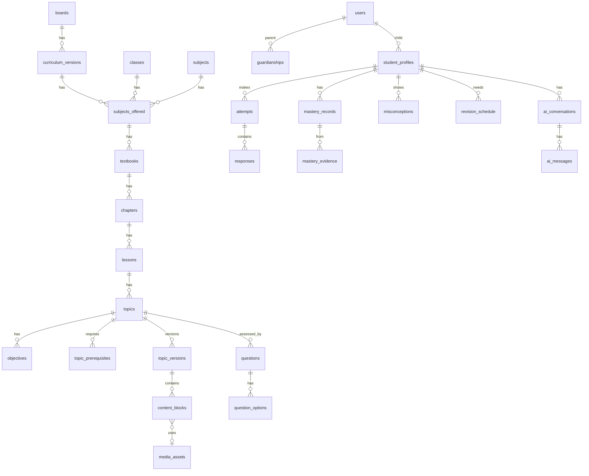

# Data model (PostgreSQL, UUID keys)

Implemented in `apps/api/src/db/schema.ts` (Drizzle). Module 1 implements the **curriculum** and **identity** groups; the rest are added by the module that owns them.

## Groups

**Curriculum** – `boards`, `curriculum_versions` (board + academic year, e.g. CBSE 2026-27), `classes` (3…12 ready), `subjects`, `subjects_offered` (version + class + subject), `textbooks` (+ edition), `chapters`, `lessons`, `topics`, `objectives`, `topic_prerequisites`. Each carries `name_en`, `name_ta`, `slug`, `position`, `source_ref` (official chapter reference, text only).

**Content** – `topic_versions` (status: draft/review/approved/published/archived, version no., author, reviewer), `content_blocks` (type, position, JSON payload validated by the shared zod schema, `provenance`), `media_assets` (kind, storage key, licence, language, duration, checksum).

**Assessment** – `questions` (type, difficulty 1-4 = basic/application/advanced/challenge, round, rubric JSON, status, version), `question_options` (with `why_wrong` explanation), `quizzes`, `exams`, `attempts`, `responses`.

**Mastery** – `mastery_records` (student, topic, state, score, confidence), `mastery_evidence` (recognition / recall / application / reasoning / teach_back / delayed), `misconceptions`, `revision_schedule` (spaced repetition due dates).

**Identity** – `users`, `student_profiles` (nickname, class, board, language pref, PIN hash), `guardianships`, `consents` (purpose, text version, timestamp, revoked_at), `sessions`.

**AI** – `ai_conversations`, `ai_messages` (moderation flags, grounding refs), `ai_usage` (per-day counters), `embeddings` (pgvector).

**Platform** – `notifications`, `rewards`, `audit_logs`, `feature_flags`, `content_reports` (student "this is wrong" reports).

## Safeguards

Foreign keys everywhere, indexes on all FK and lookup columns, unique `(parent_id, slug)` constraints, `ON DELETE` rules chosen deliberately (student deletion cascades learning data for DPDP erasure), `created_at/updated_at` on all tables, soft-delete only for curriculum, never for child data.
